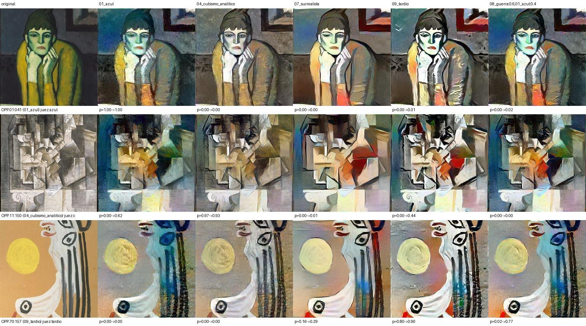

# Picasso entre períodos · avance: motor de colores

Proyecto académico del curso de IA Distribuida (CENFOTEC). La meta es **re-pintar una obra de Picasso como si la hubiera hecho en otro de sus períodos**,
con modelos entrenados con el catálogo del Online Picasso Project y una parte del entrenamiento hecha de forma distribuida (PyTorch DDP).

Este repositorio es el **avance** de ese proyecto: contiene solo el proceso de **colores** (cambiar la paleta y la textura de la pincelada de una obra hacia las de otro período),
completo y con todo su entrenamiento. El motor de forma queda para la entrega final.



*Filas: una obra del Período Azul (1901), una del Cubismo analítico (1911) y una del Tardío (1970). Columnas: la original y cinco destinos. La forma no cambia; cambian la paleta y la textura.
«p» es la probabilidad que da el juez ResNet18 al período destino, antes y después.*

## Resultados

| Etapa | Resultado |
| --- | --- |
| Dataset | 5,118 pinturas etiquetadas en 10 períodos (de 41,940 obras del catálogo), 4,093 / 512 / 513 para entrenamiento, validación y prueba |
| Clasificadores | MLP 30.8%, CNN propia 59.8% y ResNet18 79.5% de acierto en prueba (azar: 10%) |
| IA distribuida (DDP) | ResNet18 con 1, 2 y 4 procesos: 97 s, 142 s y 63 s (74.3%, 77.8% y 71.0% en prueba) |
| Motor de colores (Gatys) | El juez independiente reconoce el período destino en 10 de 12 transferencias; su probabilidad media para ese período sube de 4.5% a 41.9% |

Todo sale de archivos incluidos en el repositorio: `picasso-estilos/outputs/` (`*.json`, `log_*.txt`, `eval_jueces_resumen.csv`).
El detalle está en [`docs/informe-colores.md`](docs/informe-colores.md) y la arquitectura en [`docs/ARQUITECTURA.md`](docs/ARQUITECTURA.md).

## Estructura

Los nombres de carpeta se mantienen como en el proyecto original, porque los scripts se buscan entre sí por esas rutas.

| Carpeta | Qué contiene |
| --- | --- |
| `picasso-ai-cenfotect-main/` | **Opcional.** ETL: descarga del catálogo del Online Picasso Project (extracción, transformación, manifiesto y pruebas) |
| `picasso-estilos/` | Dataset de estilos, clasificadores, entrenamiento distribuido (DDP), motor de colores (Gatys), evaluación y explicaciones. Incluye los modelos entrenados y todos los logs |
| `picasso-simulador-colores/` | Simulador web de solo colores (puerto 8767) |
| `demo/` | Scripts para probar todo con las 40 pinturas de muestra, sin descargar nada |
| `muestras/pinturas/` | 4 pinturas de ejemplo por período, a 256 px (las 40 que usa la demostración) |
| `docs/` | Arquitectura, informe del avance e imágenes de resultados |

`picasso-ai-cenfotect-main/` y `picasso-estilos/` son copia sin modificar de las carpetas del proyecto original. Lo nuevo en este repositorio es `picasso-simulador-colores/`, `demo/` y `docs/`.

Cada carpeta tiene su propio README cuando hace falta (`picasso-ai-cenfotect-main/README.md`, `picasso-estilos/README.md`, `picasso-simulador-colores/README.md`).

## Arquitectura en una mirada

```
Online Picasso Project ──ETL──► catalog.csv + imágenes ──build_dataset──► dataset de estilos (5,118 pinturas, 10 períodos)
                                                                              │
                         ┌──────────────────────────┬───────────────────────┤
                         ▼                          ▼                       ▼
                 clasificadores              DDP (1, 2, 4 procesos)   estilo del período
                 MLP · CNN · ResNet18        ResNet18                 (matrices Gram de 16 pinturas)
                         │ jueces                                          │
                         │                                                 ▼
                         └───────────────► evaluación ◄────────── motor de colores (Gatys + VGG19)
                                           y explicaciones                  │
                                                  └──────────────► simulador web de colores
```

El diagrama completo, el flujo de datos paso a paso y las decisiones de diseño están en [`docs/ARQUITECTURA.md`](docs/ARQUITECTURA.md).

## Qué se necesita para correrlo

| Requisito | Detalle |
| --- | --- |
| Sistema operativo | Windows 10 u 11 (los scripts son `.bat`) |
| Tarjeta de video | NVIDIA con CUDA. Se usó una RTX 3080 Ti de 12 GB. El entrenamiento distribuido (DDP) la necesita; el motor de colores y el simulador corren también en CPU, pero mucho más lento |
| Driver de NVIDIA | Uno reciente, compatible con CUDA 12.4 (versión 550 o superior). No hace falta instalar el CUDA Toolkit: PyTorch trae lo necesario |
| Python | 3.11 o superior (se usó 3.13.7). Al instalarlo, marcar «Add python.exe to PATH» |
| Git | Para clonar el repositorio |
| Memoria y disco | 16 GB de RAM o más y unos 6 GB libres para el entorno de Python (~5 GB). Si se rehace el proceso completo, el catálogo descargado y el dataset suman decenas de GB más (el proyecto original estimó unos 40 GB libres en total) |
| Internet | Para instalar PyTorch y, la primera vez, para que torchvision baje VGG19 (y los pesos de ImageNet de la ResNet18) a `C:\Users\<usuario>\.cache` |

## Cómo correrlo

Todo se corre con scripts `.bat` de doble clic (o desde una terminal en la carpeta indicada).

### A. Probar el avance (sin descargar el catálogo)

Los modelos entrenados y las 40 pinturas de muestra ya vienen en el repositorio, así que esto funciona recién clonado.

1. **Crear el entorno.** Doble clic en `picasso-estilos\setup_entorno.bat`. Instala PyTorch con CUDA 12.4 y las librerías de `requirements.txt`, y al final dice si detectó la GPU.
2. **Simulador web.** Doble clic en `picasso-simulador-colores\iniciar_simulador_colores.bat`. Se abre http://127.0.0.1:8767: elige una pintura, un período destino y «Generar simulación».
   Sin el catálogo descargado, el simulador usa las 40 pinturas de muestra y arma solo el dataset de demostración (`picasso-estilos\data\muestra`).
3. **Transferencia de colores por lotes.** Doble clic en `demo\colores_muestra.bat`. Genera una grilla de 3 obras × 5 destinos y sus explicaciones en `demo\salida\outputs\transfer_muestra\`.
4. **Reentrenar con la muestra (opcional).** Doble clic en `demo\entrenar_muestra.bat`: entrena MLP, CNN, ResNet18 y DDP con 2 procesos sobre las 40 imágenes, en `demo\salida\outputs\`.
   Con solo 20 imágenes de entrenamiento el acierto no significa nada: sirve para comprobar que el entrenamiento corre de punta a punta. **No sobrescribe** los modelos reales de `picasso-estilos\outputs\`.

Con la muestra, el «estilo» de cada período sale de 2 pinturas en lugar de 16 (las más saturadas); las fichas de color de cada período son siempre las del dataset completo.
Para ver los resultados con el estilo calculado sobre las 5,118 pinturas hay que rehacer el dataset (sección B).

### B. Rehacer todo el proceso (opcional)

Para volver a hacer la descarga, el dataset y el entrenamiento completos, en este orden:

1. **Descarga del catálogo** (≈ 14 horas, reanudable). En `picasso-ai-cenfotect-main`: copiar `.env.example` a `.env`, escribir `PICASSO_USER` y `PICASSO_PASS` y correr `descargar_nivel1.bat`
   (crea su propio entorno, corre las pruebas y descarga el catálogo con imágenes). Los términos del sitio piden **autorización escrita para descargar imágenes**; este proyecto la tiene del Prof. Enrique Mallen.
   Sin ella, el ETL se corre con `--no-images` (ver su README).
2. **Dataset de estilos.** En `picasso-estilos` (con el entorno del paso A.1):
   ```
   .venv\Scripts\python -m src.data.build_dataset --src ..\picasso-ai-cenfotect-main\data
   ```
   Crea `data\styles\train|val|test\<período>\*.jpg` y reescribe `labels.csv` (el reparto es determinista, semilla 42). Las pinturas no se suben a git (están en `.gitignore`).
   El `saturation.csv` incluido (saturación media de cada obra, que decide cuáles cuentan como «a color») corresponde a ese mismo dataset y este paso no lo regenera;
   si el catálogo descargado fuera distinto, bórralo y el motor tratará todas las obras como a color.
3. **Clasificadores.** `entrenar_base.bat` entrena MLP (30 épocas), CNN (40) y ResNet18 (20) y guarda `outputs\<modelo>.pt`, `<modelo>.json` y `log_<modelo>.txt`. Esto **reemplaza** los modelos incluidos.
4. **Entrenamiento distribuido.** `entrenar_distribuido.bat` corre ResNet18 con DDP en 1, 2 y 4 procesos (8 épocas) y guarda `outputs\ddp_<n>.json` y `log_ddp_<n>.txt`.
   Sirve para medir tiempos y acierto; no guarda un modelo aparte. `repetir_ddp2.bat` repite solo la corrida de 2 procesos.
5. **Motor de colores.** `transferir_estilo.bat` genera las transferencias de la evaluación en `outputs\transfer_v2` (solo colores) y `outputs\transfer_v2_juez` (guiada por el juez).
   Para una sola obra:
   ```
   .venv\Scripts\python -m src.style_transfer.transfer --content OPP.03_026 --target 04_cubismo_analitico
   .venv\Scripts\python -m src.style_transfer.transfer --content OPP.03_026 --target "08_guerra:0.7,01_azul:0.3"
   ```
6. **Evaluación y explicaciones.** `evaluar_jueces.bat` mide las transferencias con los dos jueces (`outputs\eval_jueces.csv` y `eval_jueces_resumen.csv`).
   Para las explicaciones (en una terminal de Windows, primero `set PYTHONUTF8=1` para que se vean bien las tildes y las marcas ✓):
   `.venv\Scripts\python -m src.style_transfer.explain --results outputs\transfer_v2\results.json`.
7. **Simulador con el catálogo completo.** Con el catálogo descargado, `iniciar_simulador_colores.bat` lo detecta solo y deja elegir entre miles de obras
   (`--catalog-dir` permite apuntar a otra carpeta).

Los 10 períodos son: Formación (1881–1900), Azul (1901–1904), Rosa (1905–1906), Ibérico y africano (1907–1908), Cubismo analítico (1909–1912), Cubismo sintético (1913–1919),
Neoclásico (1920–1924), Surrealista (1925–1936), Años de guerra (1937–1945) y Tardío (1946–1973). Sus nombres de carpeta están en `build_dataset.py`.

## Modelos entrenados incluidos

Los pesos que entrenamos están en el repositorio, en la carpeta donde el código los busca, así que no hace falta volver a entrenar para usar el simulador.

| Modelo | Tamaño | Dónde está | Cómo se entrenó |
| --- | --- | --- | --- |
| Clasificador MLP | 25 MB | `picasso-estilos/outputs/mlp.pt` | `entrenar_base.bat` (log: `log_mlp.txt`) |
| Clasificador CNN (juez independiente) | 1.6 MB | `picasso-estilos/outputs/cnn.pt` | `entrenar_base.bat` (log: `log_cnn.txt`) |
| Clasificador ResNet18 (juez de colores) | 45 MB | `picasso-estilos/outputs/resnet18.pt` | `entrenar_base.bat` (log: `log_resnet18.txt`) |

El entrenamiento distribuido se usó para medir tiempos y acierto, no para guardar un modelo: sus resultados están en `ddp_1.json`, `ddp_2.json`, `ddp_4.json` y los logs `log_ddp_*.txt`.
Cada `<modelo>.json` guarda las clases, el acierto en prueba, el mejor acierto en validación y la historia época por época.

Los modelos **pre-entrenados** (VGG19 y los pesos de ImageNet con los que parte la ResNet18) no se incluyen: torchvision los descarga solo la primera vez.

## Qué no está en el repositorio

- **Las imágenes del catálogo** (miles de archivos): se descargan con el ETL. El archivo `.env` con credenciales tampoco se sube; se usa `.env.example` como plantilla.
- **El dataset de estilos completo** (`picasso-estilos/data/styles/train|val|test`): se regenera con `build_dataset`. Sí están `labels.csv` (qué obra es de qué período y en qué partición), `saturation.csv` y `perfiles_periodo.json`.
- **Los entornos de Python** (`.venv`): se crean con los scripts de instalación.
- **Las imágenes que generan las demos y el simulador** (`demo/salida`, `picasso-simulador-colores/cache`).

## Pruebas

- ETL: en `picasso-ai-cenfotect-main`, `.venv\Scripts\python -m pytest -q` (la prueba de los parsers usa HTML real guardado en `tests\fixtures`).
- Simulador de colores: `picasso-simulador-colores\probar_simulador_colores.bat`.

## Derechos

Proyecto académico, sin fines comerciales. Las obras de Pablo Picasso tienen derechos de autor de sus herederos; el repositorio no incluye el catálogo, solo unas pocas muestras de baja resolución con fines de estudio.
