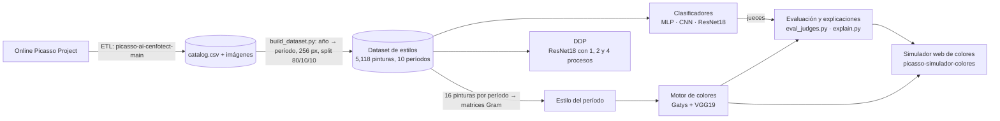

# Arquitectura (avance: motor de colores)

El sistema responde una pregunta: **¿se puede pintar una obra de Picasso con la paleta y la textura de otro de sus períodos?**
Para eso hace falta (1) datos etiquetados por período, (2) jueces que reconozcan el período de una imagen, (3) un motor que cambie los colores y
(4) una forma de medir y explicar el resultado. Cada pieza es una carpeta del repositorio.

## Vista general

## Componentes

| Carpeta | Responsabilidad | Entrada | Salida |
| --- | --- | --- | --- |
| `picasso-ai-cenfotect-main/` | **ETL**: descarga el catálogo y sus imágenes (reanudable, 1 petición por segundo) | Cuenta del Online Picasso Project (`.env`) | `data/index/catalog.csv`, imágenes, `manifest.sqlite` |
| `picasso-estilos/src/data/` | **Dataset**: filtra pinturas, etiqueta el período por año, redimensiona y divide | `catalog.csv` + imágenes | `data/styles/` (`train/val/test`, `labels.csv`) |
| `picasso-estilos/src/models/` | **Modelos**: MLP, CNN propia y ResNet18 | — | — |
| `picasso-estilos/src/train.py` | **Entrenamiento** de un clasificador | `data/styles` | `outputs/<modelo>.pt` y `.json` |
| `picasso-estilos/src/distributed/` | **IA distribuida**: DDP (paralelismo de datos) con 1, 2 y 4 procesos | `data/styles` | `outputs/ddp_<n>.json` |
| `picasso-estilos/src/style_transfer/transfer.py` | **Motor de colores** (Gatys) | Una obra, un período destino y el juez | Imagen nueva + `results.json` |
| `picasso-estilos/src/style_transfer/eval_judges.py` | **Evaluación** con dos jueces | `results.json` e imágenes generadas | `eval_jueces*.csv` |
| `picasso-estilos/src/style_transfer/explain.py` y `periodos_info.py` | **Explicaciones** para cualquier persona | `results.json`, imágenes, perfiles | `explicaciones.json` / texto |
| `picasso-simulador-colores/` | **Simulador web**: galería, cola de trabajos, caché y resultado explicado | Catálogo (ETL o muestras) + modelos | `cache/` |
| `demo/` | **Demostración** con las 40 pinturas de muestra | `muestras/pinturas` | `picasso-estilos/data/muestra`, `demo/salida/` |
| `muestras/pinturas/` | 4 pinturas de ejemplo por período (256 px) | — | — |

## Flujo de datos

1. **ETL → catálogo.** `run_pipeline` descubre las obras, baja el HTML y las imágenes (caché en `data/raw/`), y escribe `catalog.csv`.
2. **Catálogo → dataset de estilos.** `build_dataset` se queda con las pinturas con imagen y año, les pone el período según su año (10 períodos, tabla en
   `build_dataset.py`), las lleva a 256 × 256 y las reparte 80/10/10 por período (semilla 42). Después se midió la saturación de cada obra
   (`saturation.csv`); las 4,691 con saturación ≥ 0.08 son «a color» y son las únicas que aportan paleta.
3. **Dataset → jueces.** Tres clasificadores con pérdida ponderada por clase (el período Tardío tiene 23 veces más obras que el Rosa).
   La ResNet18 es el mejor (79.5%); la **CNN propia** (59.8%) se reserva como juez independiente.
4. **Dataset → DDP.** La ResNet18 se vuelve a entrenar con `torch.distributed` (backend `gloo`, un `DistributedSampler` por proceso y lote global constante de 64).
5. **Dataset → estilo de un período.** Se promedian las matrices de Gram (capas relu1_1 a relu5_1 de VGG19) de 16 pinturas a color del período, del split de entrenamiento.
   Se pueden mezclar períodos con pesos (`08_guerra:0.6,01_azul:0.4`).
6. **Motor de colores.** Se parte de la obra original y se ajustan sus píxeles 400 pasos (Adam) minimizando
   `contenido (relu4_2) + 1e6 · estilo (Gram) + 1e-2 · variación total`. No hay entrenamiento: es una optimización por imagen.
7. **Evaluación.** Dos jueces miden la probabilidad del período destino antes y después. Guiar la generación con la ResNet18 la «engaña»
   (ejemplo adversario), por eso la medición que cuenta es la de la CNN propia, que nunca participa.
8. **Explicación.** Se miden 5 rasgos (intensidad, claridad, contraste, temperatura, pincelada) y la paleta dominante, y se comparan con el promedio real del período.

## Decisiones de diseño

| Decisión | Por qué |
| --- | --- |
| Etiquetar por año en 10 períodos | Es el criterio clásico de la historiografía y el catálogo trae el año de casi todas las obras |
| Solo pinturas a color | Dibujos y grabados casi siempre son en blanco y negro; mezclarlos enseñaría a reconocer la técnica y no el período |
| Pesos por clase | El desbalance entre períodos es de 23 a 1 |
| Dos jueces, uno independiente | Medir con el mismo modelo que guía la generación sobrestima el resultado |
| DDP con `gloo` | `nccl` y `libuv` no existen en Windows; los procesos comparten una sola GPU |
| Gatys en lugar de un modelo generativo entrenado | Para el avance basta cambiar paleta y textura, y la optimización no necesita entrenamiento ni datos propios |
| Simulador sin dependencias de difusión | Solo necesita torch, torchvision, pandas y numpy; arranca en segundos |

## Qué entrena este repositorio y qué es pre-entrenado

| Componente | Origen |
| --- | --- |
| MLP, CNN propia y ResNet18 como jueces | Entrenados por nosotros con el dataset de estilos (la ResNet18 parte de pesos de ImageNet) |
| ResNet18 con DDP | Entrenada por nosotros, de forma distribuida |
| Perfiles y matrices Gram de cada período | Calculados del dataset |
| VGG19 (motor de colores) | Pre-entrenado en ImageNet (torchvision), no sabe de Picasso |

## Límites conocidos

- El motor cambia colores y textura, no la forma: no copia deformaciones, facetas ni contornos de un período.
- Los 3 modelos y los jueces se entrenaron con 4,093 imágenes de entrenamiento; los jueces aciertan entre 60% y 80% con obras reales.
- Los tiempos de DDP se midieron con varios procesos sobre **una** GPU: la mejora real del paralelismo de datos aparece con varias GPU o máquinas.
- Las obras de Picasso tienen derechos de autor de sus herederos: el repositorio solo incluye 40 pinturas de baja resolución con fines de estudio.
