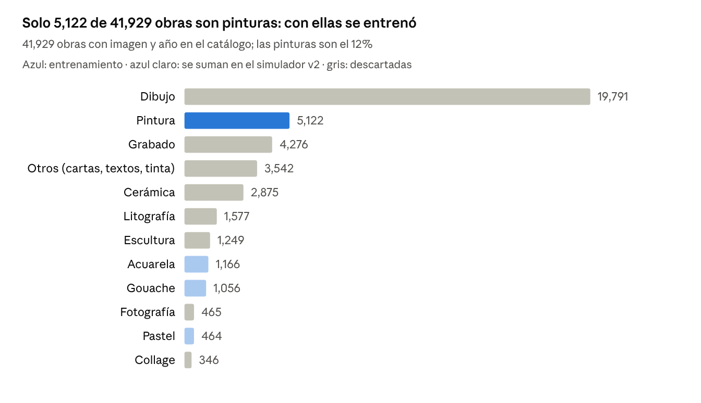
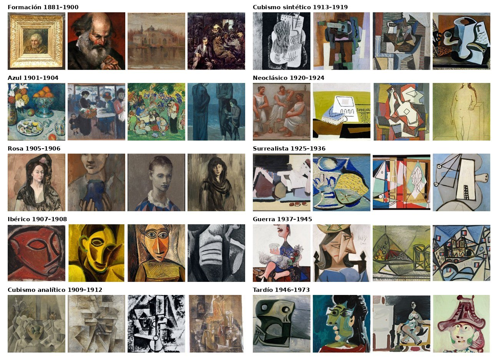
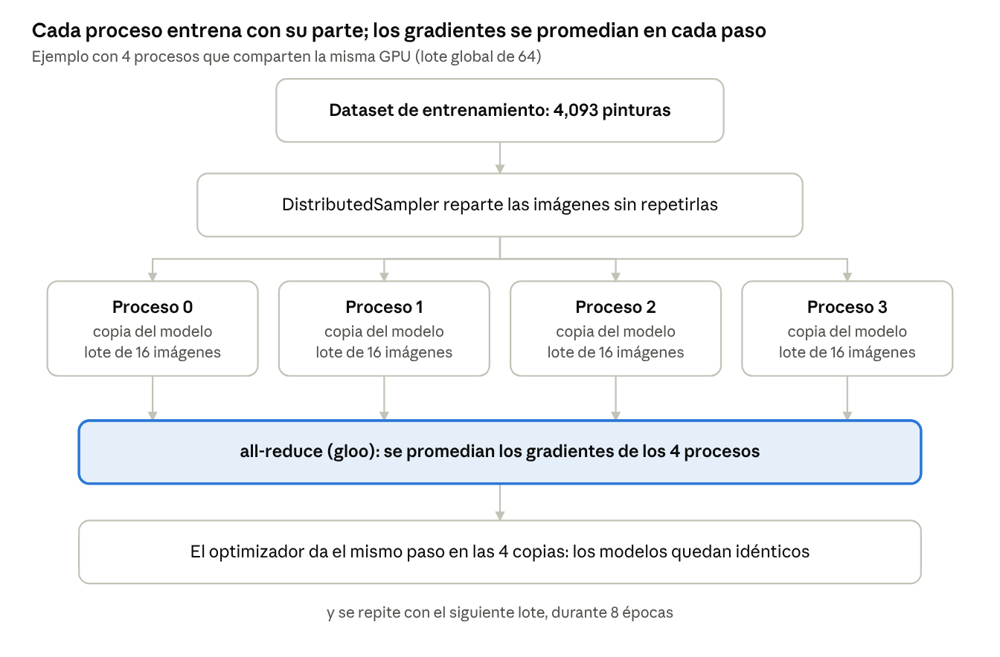
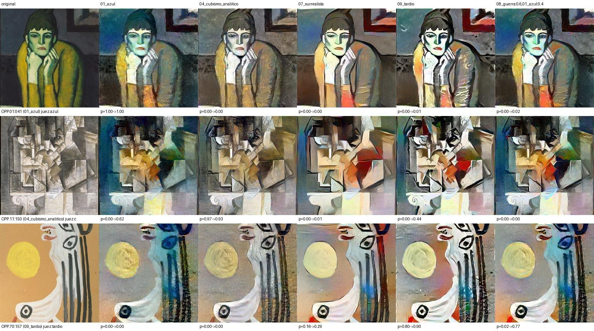

# Informe técnico (avance): motor de colores

CENFOTEC · IA Distribuida · avance del proyecto «Picasso entre períodos»

> Este documento es un extracto del informe técnico completo: reúne solo las secciones del **motor de colores** (dataset, clasificadores,
> entrenamiento distribuido con DDP y transferencia de colores con Gatys). El motor de forma (LoRA), el híbrido y el simulador completo
> quedan para la entrega final y no están en este repositorio.

## Resumen del avance

El sistema lleva una pintura de un período de Picasso a otro **cambiando su paleta y la textura de su pincelada**, y mide el resultado con
jueces entrenados por nosotros sobre un dataset propio de 5,118 pinturas etiquetadas en 10 períodos.

| Etapa | Qué se hizo | Resultado clave |
| --- | --- | --- |
| Dataset | Del catálogo de 41,940 obras a 5,118 pinturas etiquetadas en 10 períodos | Split 80/10/10 estratificado |
| Clasificadores | MLP, CNN propia y ResNet18 | 30.8%, 59.8% y 79.5% de acierto en test (azar: 10%) |
| IA distribuida (DDP) | ResNet18 con 1, 2 y 4 procesos | 97 s, 142 s y 63 s; 74.3%, 77.8% y 71.0% en test |
| Motor de colores (Gatys) | Paleta y textura del período | El juez independiente reconoce el período destino en 10 de 12 transferencias |
| Simulador de colores | Página web local con caché, comparación antes/después y explicaciones | Ver `picasso-simulador-colores/` |

Los resultados salen de los archivos incluidos en `picasso-estilos/outputs/` (`*.json`, `log_*.txt`, `eval_jueces_resumen.csv`).

## Dataset: del catálogo a los períodos

De 41,929 obras con imagen del catálogo, el dataset de entrenamiento usa **5,118 pinturas** etiquetadas en 10 períodos según su año. Las demás se descartaron porque no son pinturas a color (dibujos, grabados, fotos) o no son imágenes planas (cerámica, esculturas).

**Cómo se construyó**, con el script `build_dataset.py`:

1. **Descarga.** Un programa de extracción propio bajó el catálogo del Online Picasso Project: 41,940 registros con título, año, lugar, técnica y categoría, y 41,929 imágenes. Todo quedó en un manifiesto (`catalog.csv`) y una base SQLite.
2. **Filtro.** Solo la categoría *painting* con imagen y año conocido: 5,122 obras. Cuatro no se pudieron abrir y quedaron 5,118.
3. **Etiqueta = período por año**, con los rangos clásicos de la historiografía (tabla abajo).
4. **Imagen:** se redimensiona a 256 px por el lado corto y se recorta al centro (256 × 256).
5. **Split 80/10/10** dentro de cada período (estratificado, semilla 42), para que validación y prueba tengan obras de todos los períodos.
6. **Color:** se midió la saturación media de cada obra; 4,691 tienen color real (saturación ≥ 0.08). Solo esas se usan para aprender paletas y para el LoRA, que entrenó con las 3,756 de entrenamiento.

| Período | Años | Entrenamiento | Validación | Prueba | Total |
| --- | --- | --- | --- | --- | --- |
| Formación | 1881–1900 | 270 | 34 | 34 | 338 |
| Azul | 1901–1904 | 199 | 25 | 25 | 249 |
| Rosa | 1905–1906 | 69 | 9 | 9 | 87 |
| Ibérico y africano | 1907–1908 | 87 | 11 | 11 | 109 |
| Cubismo analítico | 1909–1912 | 194 | 24 | 24 | 242 |
| Cubismo sintético | 1913–1919 | 242 | 30 | 30 | 302 |
| Neoclásico | 1920–1924 | 332 | 42 | 42 | 416 |
| Surrealista | 1925–1936 | 449 | 56 | 56 | 561 |
| Años de guerra | 1937–1945 | 613 | 77 | 77 | 767 |
| Tardío | 1946–1973 | 1,638 | 204 | 205 | 2,047 |
| **Total** |  | **4,093** | **512** | **513** | **5,118** |

*Fuente: `labels.csv` del dataset de estilos. El Período Tardío aporta el 40% de las pinturas.*

**Por qué no se usaron todos los datos.** Los dibujos y grabados son casi siempre en blanco y negro y no enseñan paletas. La cerámica y la escultura son objetos 3D fotografiados, y "otros" incluye cartas y textos. Mezclarlos habría enseñado a los modelos a reconocer la técnica y no el período. El desbalance entre períodos (Tardío tiene 23 veces más obras que Rosa) se compensó con pesos por clase al entrenar.

*Muestra del dataset: cuatro pinturas de entrenamiento de cada período, a 256 px (también en `muestras/pinturas/`).*

## Entrenamiento e IA distribuida

El mejor clasificador de períodos, una ResNet18, acierta el período de una pintura que nunca vio en **79.5%** de los casos (el azar sería 10%). Ese mismo modelo se entrenó después con DDP en 1, 2 y 4 procesos para demostrar el entrenamiento distribuido.

### Tres clasificadores

| Modelo | Qué es | Acierto en prueba | Mejor validación |
| --- | --- | --- | --- |
| MLP | Red densa sobre píxeles: línea base | 30.8% | 27.7% |
| CNN propia | Red convolucional pequeña, entrenada desde cero | 59.8% | 60.4% |
| ResNet18 | Red pre-entrenada en ImageNet y re-entrenada con nuestro dataset (transfer learning) | **79.5%** | 83.6% |

Detalles comunes: pérdida de entropía cruzada **con pesos por clase**, optimizador AdamW, tasa de aprendizaje con decaimiento coseno y aumento de datos (variaciones aleatorias de cada imagen en cada época). La CNN propia, que no vio ImageNet, es la que después se usa como **juez de colores independiente**: no participa en ninguna generación.

### Entrenamiento distribuido con DDP

DDP (*DistributedDataParallel* de PyTorch) es paralelismo de datos: cada proceso tiene una copia del modelo y recibe una porción distinta de las imágenes. En cada paso, los procesos calculan sus gradientes y los **promedian entre todos** (operación *all-reduce*), así que todas las copias quedan siempre idénticas.

- **Backend `gloo`** e inicialización por archivo, porque en Windows no existen NCCL ni libuv.
- **`DistributedSampler`** reparte las imágenes sin repetirlas entre procesos.
- **Lote global constante de 64:** con 2 procesos cada uno usa 32, con 4 cada uno usa 16.
- **8 épocas, ResNet18,** los procesos comparten la única GPU.

| Procesos | Tiempo de entrenamiento | Acierto en validación | Acierto en prueba |
| --- | --- | --- | --- |
| 1 | 97 s | 72.1% | 74.3% |
| 2 | 142 s | 79.7% | 77.8% |
| 4 | **63 s** | 75.0% | 71.0% |

**Lectura.** Con 4 procesos el entrenamiento fue 1.5 veces más rápido, porque cada proceso decodifica sus imágenes en paralelo y la GPU espera menos. Con 2 fue más lento: la sincronización de gradientes por `gloo` pasó por la CPU y no compensó. Las diferencias de acierto (71–78%) están dentro de la variación normal con 513 obras de prueba. La limitación honesta: **son varios procesos en una sola GPU**; la ganancia real del paralelismo de datos aparece con varias GPU o varias máquinas.

## Motor de colores (Gatys) y explicaciones

El motor de colores cambia la **paleta y la textura de la pincelada** de una obra hacia el promedio real de un período, sin tocar su forma. Un juez independiente (la CNN propia) reconoce el período destino en **10 de 12** transferencias de prueba, y su probabilidad media para ese período sube de 4.5% a 41.9%.

1. Una red VGG19 pre-entrenada "mira" las imágenes: sus capas profundas describen **qué hay** (contenido, relu4_2) y sus matrices de Gram describen **cómo está pintado** (estilo, relu1_1 a relu5_1).
2. El **estilo de un período** es el promedio de las matrices de Gram de 16 pinturas a color de ese período, del split de entrenamiento.
3. Se parte de la obra original y se ajustan sus píxeles durante 400 pasos (Adam) para que conserve su contenido y se acerque al estilo del período.
4. Se pueden **mezclar influencias** (por ejemplo, 60% Guerra y 40% Azul) promediando sus matrices de Gram.

*Filas: Azul 1901, Cubismo analítico 1911 y Tardío 1970. Columnas: cinco destinos. La forma no cambia; cambian la paleta y la textura. "p" = probabilidad de la ResNet18 para el período destino, antes y después.*

**Una lección de evaluación.** Guiar la generación con la ResNet18 subió su propia probabilidad (de 10.6% a 28.7%), pero la CNN independiente casi no cambió (41.9% contra 43.1%): la imagen aprendió a engañar a ese juez, un **ejemplo adversario**. Por eso todas las mediciones usan jueces que no participan en la generación.

**Explicaciones para cualquier persona:** cinco rasgos medidos (intensidad del color, claridad, contraste, temperatura y pincelada) comparados con el promedio real del período; la paleta dominante con nombres en español (k-means); una ficha histórica del período; y lo que el motor no puede copiar.

## Qué entrenamos nosotros y qué es pre-entrenado

| Componente | ¿Lo entrenamos? | Para qué se usa |
| --- | --- | --- |
| Clasificadores MLP, CNN y ResNet18 | **Sí** | Jueces de colores |
| ResNet18 con DDP (1, 2 y 4 procesos) | **Sí** (distribuido) | Demostrar el entrenamiento distribuido |
| Estilo de cada período (Gram) y perfiles de color | Calculados del dataset | Paleta y comparación de rasgos |
| VGG19 | No, pre-entrenado | Describe contenido y estilo; no sabe de Picasso |

## Limitaciones

- El motor de colores no cambia la forma: no puede copiar deformaciones de cuerpos, facetas cubistas ni contornos del período.
- Los jueces son imperfectos (60–80% con obras reales) y el DDP corrió en una sola GPU, con varios procesos que la comparten.
- La muestra de evaluación del motor de colores es pequeña (12 transferencias).
- Las obras tienen derechos de autor de los herederos de Picasso: el repositorio no incluye el catálogo, solo 40 pinturas de baja resolución con fines de estudio.
